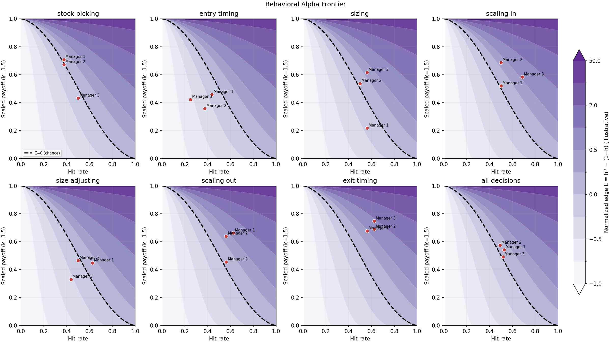
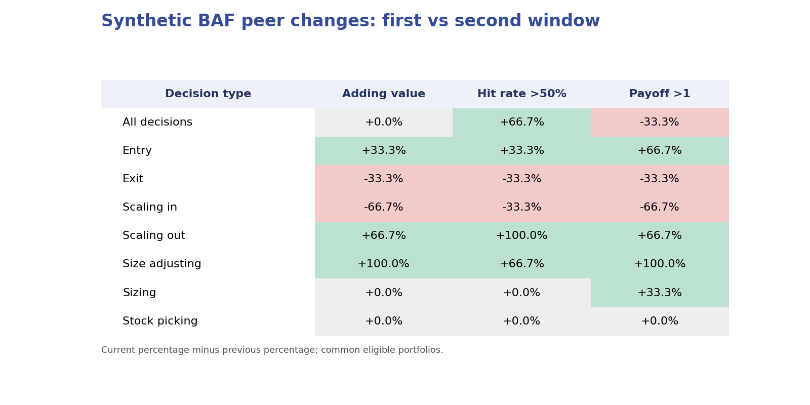
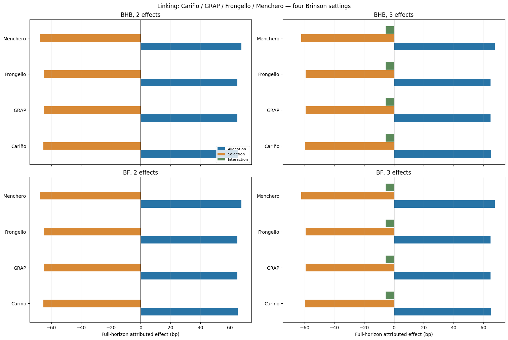
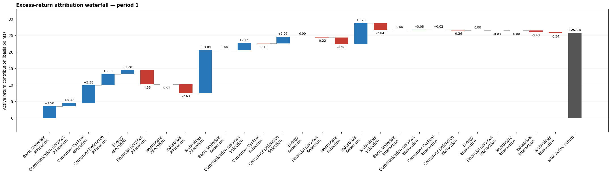
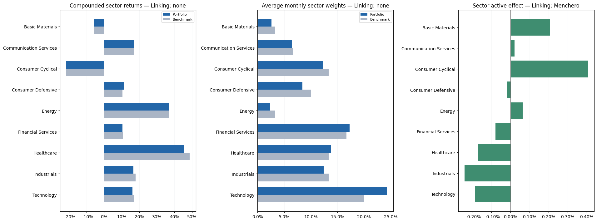
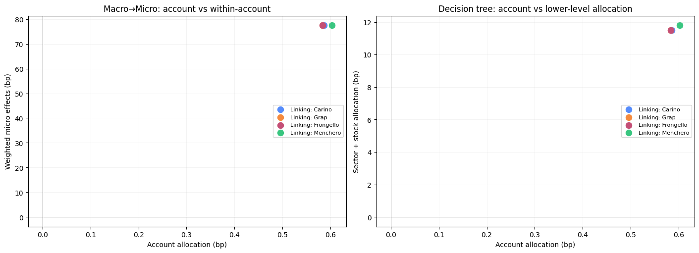

# brinsons

[English](README.md) · **简体中文**

基于 **Polars 表达式**的组合绩效归因库，提供单期 Brinson、多期归因链接、
多账户决策归因、货币与因子扩展，以及独立定义的行为阿尔法前沿（BAF）。
核心运行依赖只有 Polars；绘图使用可选的 Matplotlib。
[Sphinx 方法文档](docs/source/index.md)列出公式、输入约束、API 和校验方法。

## 教程图示

以下图片来自**已执行的 Jupyter 教程**。BAF 与多账户示例使用虚构数据；
道琼斯 30 示例使用本地 Yahoo Finance 研究快照。所有教程均有[中英文版本](tutorials/README.md)。

### 行为阿尔法前沿

七类决策、弯曲的零增值边界和按归一化增值绘制的无差异色带。
变化表使用同一批有效账户，显示本期百分比减去上期百分比，统一以 `%` 展示。
具体计算见[BAF 公式文档](docs/source/behavioral-alpha-frontier.md)。





[打开中文 BAF 教程](tutorials/zh/behavioral_alpha_frontier.ipynb)

### 单期与多期 Brinson

比较 BHB 与 Brinson–Fachler，选择 Cariño、GRAP、Frongello、Menchero 或
Geometric 多期链接，并把配置、选择、交互效应追溯至超额收益。





[单期教程](tutorials/zh/single_period_attribution.ipynb) ·
[多期教程](tutorials/zh/multiple_period_attribution.ipynb)

### 道琼斯 30 与多账户

行业收益、权重、归因结果及账户到行业、证券的决策树可以在教程中交互查看。





[道琼斯 30 教程](tutorials/zh/dow30_brinson_interactive.ipynb) ·
[多账户教程](tutorials/zh/multi_account_attribution.ipynb)

## 安装与快速运行

项目支持 Python 3.11 及以上版本。权重、收益率和归因效应使用小数口径：
`0.01` 表示 1%，即 100 基点。图表及教程依赖可按需安装。

```sh
python -m pip install -e ".[tutorial,docs,test]"
python -m pytest -q
python -m sphinx -b html -W --keep-going docs/source docs/_build/html
```

```python
import polars as pl
from brinsons import calculate_single_period, calculate_multiple_period
from brinsons import bhb, fachler, link_carino

facts = pl.DataFrame({
    "period": [1, 1, 2, 2],
    "segment": ["Equity", "Bonds", "Equity", "Bonds"],
    "portfolio_weight": [.6, .4, .55, .45],
    "benchmark_weight": [.5, .5, .5, .5],
    "portfolio_return": [.12, .04, .03, .01],
    "benchmark_return": [.10, .06, .02, .015],
})

single = calculate_single_period(facts, period=1, attribution=bhb)
multiple = calculate_multiple_period(facts, attribution=fachler, linking=link_carino)
print(single.summary)
print(multiple.linked.summary)
```

输入列名无需预先重命名：各计算函数提供 `column_period`、`column_segment`、
`column_portfolio_weight` 等参数，并在结果的列名配置对象中保留映射。
`calculate_single_period` 与 `calculate_multiple_period` 是明确分开的核心入口，
每种 Brinson 与链接算法也分别有独立函数。完整约束参见
[数据契约](docs/source/data-contract.md)与[API 文档](docs/source/api.rst)。

## 方法和数据

| 功能 | 入口或文档 |
|---|---|
| BHB / Brinson–Fachler | [`bhb`、`fachler`](docs/source/single-period.md) |
| Cariño / GRAP / Frongello / Menchero / Geometric | [多期链接公式](docs/source/linking.md) |
| 多账户 Macro→Micro、价值加权总组合、层级决策归因 | [多账户文档](docs/source/multi-account.md) |
| Karnosky–Singer 简化货币拆分与货币溢价 | [货币归因](docs/source/currency.md) |
| Hentschel 约束因子与交互调整 | [Hentschel 方法](docs/source/hentschel.md) |
| BAF 七类决策、前沿图和账户变化表 | [BAF 公式](docs/source/behavioral-alpha-frontier.md) |

示例 CSV 位于 `data/dow30_brinson/`、`data/multi_account/` 和 `data/baf/`。
可用 `python scripts/generate_multi_account_data.py` 与
`python scripts/generate_baf_data.py` 重新生成虚构数据。
`data/dow30/Dow30_prices_sectors.xlsx` 为本地价格与行业工作簿；
`outputs/dow30_brinson/` 保存归因分析工作簿和图表。

BAF 是本项目独立定义的方法集合。参考论文没有公开全部决策算法、精确的
Payoff 变换或官方综合分数映射；本项目不会把计算结果标为 Essentia 官方分数。
各决策值也不是可以加总并与 Brinson 主动收益勾稽的归因效应。

## 校验与许可

`python -m pytest -q` 运行数值与图示测试。与 pybrinson 的对照测试使用
[`tests/vendor`](tests/vendor/README.md) 中保留 MIT 许可的测试参考实现，
该参考实现不属于运行依赖。项目许可证见 [LICENSE](LICENSE)。
